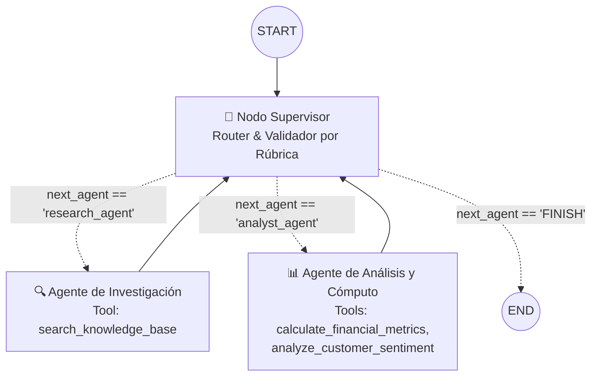

# Pre-entrega 6: Orquestador Multi-Agente Especializado

Prototipo funcional de un **Orquestador Multi-Agente de Análisis e Investigación** construido con **LangGraph**, **LangChain** y **Groq API** (`openai/gpt-oss-120b`). El sistema resuelve consultas complejas coordinando dos dominios de especialización independientes (Investigación Documental y Análisis Cuantitativo/Sentimiento) bajo el control de un nodo Supervisor validador.

---

## 📐 Diagrama de Arquitectura del Grafo



---

## 🧠 Justificación de la Topología y Manejo de Conflictos

### ¿Por qué se eligió la Topología Jerárquica (Patrón Supervisor)?
Se seleccionó una **topología jerárquica centralizada** por encima de una arquitectura *peer-to-peer* (red libre entre agentes) por tres motivos de ingeniería:
1. **Control determinista del flujo:** Un único nodo (`supervisor`) posee la visión global del objetivo del usuario y decide dinámicamente el enrutamiento mediante salidas estructuradas (`with_structured_output` con `Literal["research_agent", "analyst_agent", "FINISH"]`). Ningún especialista puede invocar a otro por su cuenta.
2. **Separación estricta de responsabilidades (Single Responsibility):** El `research_agent` solo tiene acceso a herramientas de búsqueda documental y tiene prohibido calcular métricas; el `analyst_agent` solo tiene acceso a herramientas de cómputo matemático y análisis de sentimiento.
3. **Auditoría y Síntesis unificada:** Al obligar a todos los especialistas a retornar siempre al Supervisor (`add_edge("research_agent", "supervisor")` y `add_edge("analyst_agent", "supervisor")`), se garantiza una fase de validación previa antes de redactar la síntesis final.

### ¿Cómo se manejan los posibles conflictos entre agentes?
En sistemas multi-agente suelen ocurrir tres grandes conflictos: **pisado de información**, **contaminación de contexto** y **bucles infinitos de desacuerdo ("Supervisor Infinito")**. En este proyecto se resuelven mediante:

1. **Aislamiento de Estado en `OrchestratorState` (`state.py`):**
   Para evitar que un agente sobrescriba o altere el trabajo del otro, cada especialista escribe su resultado en un campo exclusivo del estado compartido (`research_data` para el investigador y `analysis_data` para el analista), además de registrar su traza identificada con `name` en la lista `messages`.
2. **Prevención de Contaminación de Contexto:**
   En lugar de enviar todo el historial crudo de mensajes y llamadas a herramientas a cada nodo, el Supervisor genera una orden puntual (`current_instruction`). El Agente Analista recibe únicamente esa instrucción acotada y el bloque limpio de `research_data`, evitando alucinaciones por exceso de tokens irrelevantes.
3. **Resolución de Bucles y "Supervisor Infinito":**
   - **Rúbrica de Suficiencia en el Supervisor:** El Supervisor evalúa una lista de verificación estricta (1° verificar existencia de datos crudos, 2° verificar cálculos financieros y sentimiento, 3° sintetizar y emitir `FINISH`).
   - **Límite duro de iteraciones (`MAX_ITERATIONS = 5`):** El estado rastrea `iteration_count` en cada paso por el Supervisor. Si algún agente falla reiteradamente o entra en conflicto devolviendo datos incompletos, al alcanzar la iteración máxima el Supervisor fuerza una salida controlada (`FINISH`) entregando un reporte con la información recolectada hasta ese momento.

---

## 📂 Estructura del Repositorio

```text
├── agents/
│   ├── __init__.py
│   ├── research_agent.py   # Especialista en búsqueda con tool search_knowledge_base
│   └── analyst_agent.py    # Especialista en cómputo con tools financieras y de sentimiento
├── state.py                # Esquema OrchestratorState heredando de MessagesState
├── main.py                 # Nodo Supervisor, construcción del StateGraph y caso de prueba
├── requirements.txt        # Dependencias del proyecto
├── .env                    # Variables de entorno (API Key)
└── README.md               # Documentación y arquitectura
```

---

## 🚀 Instrucciones de Instalación y Ejecución

### 1. Prerrequisitos
* Python 3.10 o superior instalado.
* Una API Key gratuita de [Groq Cloud](https://console.groq.com/keys).

### 2. Clonar el repositorio y crear el entorno virtual
Abre una terminal en la carpeta del proyecto y ejecuta:

**En Windows (PowerShell):**
```powershell
python -m venv venv
.\venv\Scripts\Activate.ps1
pip install -r requirements.txt
```

**En Linux / macOS:**
```bash
python3 -m venv venv
source venv/bin/activate
pip install -r requirements.txt
```

### 3. Configurar las variables de entorno
Crea un archivo llamado `.env` en la raíz del proyecto con el siguiente contenido:
```env
GROQ_API_KEY=gsk_tu_api_key_aqui
MODEL_NAME=openai/gpt-oss-120b
```

### 4. Ejecutar la prueba del Orquestador
Para lanzar la consulta de prueba que obliga al Supervisor a delegar la tarea al Investigador, recibir los datos, enviarlos al Analista y finalmente sintetizar la respuesta, ejecuta:

```bash
python main.py
```

### 5. Salida esperada en consola
Al ejecutar `python main.py`, verás en tiempo real la traza de delegación:
1. Impresión del esquema Mermaid del grafo compilado.
2. `[SUPERVISOR - Paso 1]` -> Enruta hacia `research_agent`.
3. `[RESEARCH AGENT]` -> Consulta la base de conocimiento para extraer ingresos, costos y reseñas de NVIDIA y Mercado Libre.
4. `[SUPERVISOR - Paso 2]` -> Valida los datos recolectados y enruta hacia `analyst_agent`.
5. `[ANALYST AGENT]` -> Ejecuta las herramientas `calculate_financial_metrics` y `analyze_customer_sentiment`.
6. `[SUPERVISOR - Paso 3]` -> Valida la rúbrica final, marca `FINISH` e imprime el informe ejecutivo comparativo.